# Projects and dependencies analysis

This document provides a comprehensive overview of the projects and their dependencies in the context of upgrading to .NETCoreApp,Version=v10.0.

## Table of Contents

- [Executive Summary](#executive-Summary)
  - [Highlevel Metrics](#highlevel-metrics)
  - [Projects Compatibility](#projects-compatibility)
  - [Package Compatibility](#package-compatibility)
  - [API Compatibility](#api-compatibility)
  - [Binding Redirect Configuration](#binding-redirect-configuration)
- [Aggregate NuGet packages details](#aggregate-nuget-packages-details)
- [Top API Migration Challenges](#top-api-migration-challenges)
  - [Technologies and Features](#technologies-and-features)
  - [Most Frequent API Issues](#most-frequent-api-issues)
- [Projects Relationship Graph](#projects-relationship-graph)
- [Project Details](#project-details)

  - [NuntivusServer.Api\NuntivusServer.Api.csproj](#nuntivusserverapinuntivusserverapicsproj)
  - [NuntivusServer.Application\NuntivusServer.Application.csproj](#nuntivusserverapplicationnuntivusserverapplicationcsproj)
  - [NuntivusServer.Common\NuntivusServer.Common.csproj](#nuntivusservercommonnuntivusservercommoncsproj)
  - [NuntivusServer.Contracts\NuntivusServer.Contracts.csproj](#nuntivusservercontractsnuntivusservercontractscsproj)
  - [NuntivusServer.Dashboard\nuntivusserver.dashboard.esproj](#nuntivusserverdashboardnuntivusserverdashboardesproj)
  - [NuntivusServer.Domain\NuntivusServer.Domain.csproj](#nuntivusserverdomainnuntivusserverdomaincsproj)
  - [NuntivusServer.Infastructure\NuntivusServer.Infastructure.csproj](#nuntivusserverinfastructurenuntivusserverinfastructurecsproj)
  - [NuntivusServer.IntegrationTests\NuntivusServer.IntegrationTests.csproj](#nuntivusserverintegrationtestsnuntivusserverintegrationtestscsproj)
  - [NuntivusServer.UnitTests\NuntivusServer.UnitTests.csproj](#nuntivusserverunittestsnuntivusserverunittestscsproj)
  - [NuntivusServer.Worker\NuntivusServer.Worker.csproj](#nuntivusserverworkernuntivusserverworkercsproj)

## Executive Summary

### Highlevel Metrics

| Metric | Count | Status |
| :--- | :---: | :--- |
| Total Projects | 10 | All require upgrade |
| Total NuGet Packages | 126 | 8 need upgrade |
| Total Code Files | 569 |  |
| Total Code Files with Incidents | 118 |  |
| Total Lines of Code | 51734 |  |
| Total Number of Issues | 675 |  |
| Estimated LOC to modify | 655+ | at least 1,3% of codebase |

### Projects Compatibility

| Project | Target Framework | Difficulty | Package Issues | API Issues | Binding Issues | Est. LOC Impact | Description |
| :--- | :---: | :---: | :---: | :---: | :---: | :---: | :--- |
| [NuntivusServer.Api\NuntivusServer.Api.csproj](#nuntivusserverapinuntivusserverapicsproj) | net8.0 | 🟢 Low | 2 | 65 | 0 | 65+ | AspNetCore, Sdk Style = True |
| [NuntivusServer.Application\NuntivusServer.Application.csproj](#nuntivusserverapplicationnuntivusserverapplicationcsproj) | net8.0 | 🟢 Low | 0 | 57 | 0 | 57+ | ClassLibrary, Sdk Style = True |
| [NuntivusServer.Common\NuntivusServer.Common.csproj](#nuntivusservercommonnuntivusservercommoncsproj) | net8.0 | 🟢 Low | 0 | 0 | 0 |  | ClassLibrary, Sdk Style = True |
| [NuntivusServer.Contracts\NuntivusServer.Contracts.csproj](#nuntivusservercontractsnuntivusservercontractscsproj) | net8.0 | 🟢 Low | 0 | 0 | 0 |  | ClassLibrary, Sdk Style = True |
| [NuntivusServer.Dashboard\nuntivusserver.dashboard.esproj](#nuntivusserverdashboardnuntivusserverdashboardesproj) | net6.0 | 🟢 Low | 0 | 0 | 0 |  | DotNetCoreApp, Sdk Style = True |
| [NuntivusServer.Domain\NuntivusServer.Domain.csproj](#nuntivusserverdomainnuntivusserverdomaincsproj) | net8.0 | 🟢 Low | 0 | 0 | 0 |  | ClassLibrary, Sdk Style = True |
| [NuntivusServer.Infastructure\NuntivusServer.Infastructure.csproj](#nuntivusserverinfastructurenuntivusserverinfastructurecsproj) | net8.0 | 🟢 Low | 3 | 74 | 0 | 74+ | ClassLibrary, Sdk Style = True |
| [NuntivusServer.IntegrationTests\NuntivusServer.IntegrationTests.csproj](#nuntivusserverintegrationtestsnuntivusserverintegrationtestscsproj) | net8.0 | 🟢 Low | 2 | 396 | 0 | 396+ | DotNetCoreApp, Sdk Style = True |
| [NuntivusServer.UnitTests\NuntivusServer.UnitTests.csproj](#nuntivusserverunittestsnuntivusserverunittestscsproj) | net8.0 | 🟢 Low | 1 | 27 | 0 | 27+ | DotNetCoreApp, Sdk Style = True |
| [NuntivusServer.Worker\NuntivusServer.Worker.csproj](#nuntivusserverworkernuntivusserverworkercsproj) | net8.0 | 🟢 Low | 2 | 36 | 0 | 36+ | DotNetCoreApp, Sdk Style = True |

### Package Compatibility

| Status | Count | Percentage |
| :--- | :---: | :---: |
| ✅ Compatible | 118 | 93,7% |
| ⚠️ Incompatible | 2 | 1,6% |
| 🔄 Upgrade Recommended | 6 | 4,8% |
| ***Total NuGet Packages*** | ***126*** | ***100%*** |

### API Compatibility

| Category | Count | Impact |
| :--- | :---: | :--- |
| 🔴 Binary Incompatible | 5 | High - Require code changes |
| 🟡 Source Incompatible | 161 | Medium - Needs re-compilation and potential conflicting API error fixing |
| 🔵 Behavioral change | 489 | Low - Behavioral changes that may require testing at runtime |
| ✅ Compatible | 71861 |  |
| ***Total APIs Analyzed*** | ***72516*** |  |

## Aggregate NuGet packages details

| Package | Current Version | Suggested Version | Projects | Description |
| :--- | :---: | :---: | :--- | :--- |
| AWSSDK.Core | 3.7.300.18 |  | [NuntivusServer.Api.csproj](#nuntivusserverapinuntivusserverapicsproj) [NuntivusServer.Infastructure.csproj](#nuntivusserverinfastructurenuntivusserverinfastructurecsproj) [NuntivusServer.IntegrationTests.csproj](#nuntivusserverintegrationtestsnuntivusserverintegrationtestscsproj) [NuntivusServer.UnitTests.csproj](#nuntivusserverunittestsnuntivusserverunittestscsproj) [NuntivusServer.Worker.csproj](#nuntivusserverworkernuntivusserverworkercsproj) | ✅Compatible |
| AWSSDK.S3 | 3.7.301 |  | [NuntivusServer.Api.csproj](#nuntivusserverapinuntivusserverapicsproj) [NuntivusServer.Infastructure.csproj](#nuntivusserverinfastructurenuntivusserverinfastructurecsproj) [NuntivusServer.IntegrationTests.csproj](#nuntivusserverintegrationtestsnuntivusserverintegrationtestscsproj) [NuntivusServer.UnitTests.csproj](#nuntivusserverunittestsnuntivusserverunittestscsproj) [NuntivusServer.Worker.csproj](#nuntivusserverworkernuntivusserverworkercsproj) | ✅Compatible |
| AWSSDK.SQS | 3.7.300.18 |  | [NuntivusServer.Api.csproj](#nuntivusserverapinuntivusserverapicsproj) [NuntivusServer.Infastructure.csproj](#nuntivusserverinfastructurenuntivusserverinfastructurecsproj) [NuntivusServer.IntegrationTests.csproj](#nuntivusserverintegrationtestsnuntivusserverintegrationtestscsproj) [NuntivusServer.UnitTests.csproj](#nuntivusserverunittestsnuntivusserverunittestscsproj) [NuntivusServer.Worker.csproj](#nuntivusserverworkernuntivusserverworkercsproj) | ✅Compatible |
| BouncyCastle.Cryptography | 2.7.0 |  | [NuntivusServer.IntegrationTests.csproj](#nuntivusserverintegrationtestsnuntivusserverintegrationtestscsproj) | ✅Compatible |
| Confluent.Kafka | 2.5.3 |  | [NuntivusServer.Api.csproj](#nuntivusserverapinuntivusserverapicsproj) [NuntivusServer.Infastructure.csproj](#nuntivusserverinfastructurenuntivusserverinfastructurecsproj) [NuntivusServer.IntegrationTests.csproj](#nuntivusserverintegrationtestsnuntivusserverintegrationtestscsproj) [NuntivusServer.UnitTests.csproj](#nuntivusserverunittestsnuntivusserverunittestscsproj) [NuntivusServer.Worker.csproj](#nuntivusserverworkernuntivusserverworkercsproj) | ✅Compatible |
| coverlet.collector | 6.0.0 |  | [NuntivusServer.IntegrationTests.csproj](#nuntivusserverintegrationtestsnuntivusserverintegrationtestscsproj) [NuntivusServer.UnitTests.csproj](#nuntivusserverunittestsnuntivusserverunittestscsproj) | ✅Compatible |
| Dapper | 2.1.79 |  | [NuntivusServer.Api.csproj](#nuntivusserverapinuntivusserverapicsproj) [NuntivusServer.Infastructure.csproj](#nuntivusserverinfastructurenuntivusserverinfastructurecsproj) [NuntivusServer.IntegrationTests.csproj](#nuntivusserverintegrationtestsnuntivusserverintegrationtestscsproj) [NuntivusServer.UnitTests.csproj](#nuntivusserverunittestsnuntivusserverunittestscsproj) [NuntivusServer.Worker.csproj](#nuntivusserverworkernuntivusserverworkercsproj) | ✅Compatible |
| Docker.DotNet.Enhanced | 4.3.3 |  | [NuntivusServer.IntegrationTests.csproj](#nuntivusserverintegrationtestsnuntivusserverintegrationtestscsproj) | ✅Compatible |
| Docker.DotNet.Enhanced.Handler.Abstractions | 4.3.3 |  | [NuntivusServer.IntegrationTests.csproj](#nuntivusserverintegrationtestsnuntivusserverintegrationtestscsproj) | ✅Compatible |
| Docker.DotNet.Enhanced.LegacyHttp | 4.3.3 |  | [NuntivusServer.IntegrationTests.csproj](#nuntivusserverintegrationtestsnuntivusserverintegrationtestscsproj) | ✅Compatible |
| Docker.DotNet.Enhanced.NativeHttp | 4.3.3 |  | [NuntivusServer.IntegrationTests.csproj](#nuntivusserverintegrationtestsnuntivusserverintegrationtestscsproj) | ✅Compatible |
| Docker.DotNet.Enhanced.NPipe | 4.3.3 |  | [NuntivusServer.IntegrationTests.csproj](#nuntivusserverintegrationtestsnuntivusserverintegrationtestscsproj) | ✅Compatible |
| Docker.DotNet.Enhanced.Unix | 4.3.3 |  | [NuntivusServer.IntegrationTests.csproj](#nuntivusserverintegrationtestsnuntivusserverintegrationtestscsproj) | ✅Compatible |
| Docker.DotNet.Enhanced.X509 | 4.3.3 |  | [NuntivusServer.IntegrationTests.csproj](#nuntivusserverintegrationtestsnuntivusserverintegrationtestscsproj) | ✅Compatible |
| Humanizer.Core | 2.14.1 |  | [NuntivusServer.Api.csproj](#nuntivusserverapinuntivusserverapicsproj) [NuntivusServer.Infastructure.csproj](#nuntivusserverinfastructurenuntivusserverinfastructurecsproj) [NuntivusServer.IntegrationTests.csproj](#nuntivusserverintegrationtestsnuntivusserverintegrationtestscsproj) [NuntivusServer.UnitTests.csproj](#nuntivusserverunittestsnuntivusserverunittestscsproj) [NuntivusServer.Worker.csproj](#nuntivusserverworkernuntivusserverworkercsproj) | ✅Compatible |
| Json.More.Net | 2.1.1 |  | [NuntivusServer.Api.csproj](#nuntivusserverapinuntivusserverapicsproj) [NuntivusServer.Infastructure.csproj](#nuntivusserverinfastructurenuntivusserverinfastructurecsproj) [NuntivusServer.IntegrationTests.csproj](#nuntivusserverintegrationtestsnuntivusserverintegrationtestscsproj) [NuntivusServer.UnitTests.csproj](#nuntivusserverunittestsnuntivusserverunittestscsproj) [NuntivusServer.Worker.csproj](#nuntivusserverworkernuntivusserverworkercsproj) | ✅Compatible |
| JsonPointer.Net | 5.3.1 |  | [NuntivusServer.Api.csproj](#nuntivusserverapinuntivusserverapicsproj) [NuntivusServer.Infastructure.csproj](#nuntivusserverinfastructurenuntivusserverinfastructurecsproj) [NuntivusServer.IntegrationTests.csproj](#nuntivusserverintegrationtestsnuntivusserverintegrationtestscsproj) [NuntivusServer.UnitTests.csproj](#nuntivusserverunittestsnuntivusserverunittestscsproj) [NuntivusServer.Worker.csproj](#nuntivusserverworkernuntivusserverworkercsproj) | ✅Compatible |
| JsonSchema.Net | 7.4.0 |  | [NuntivusServer.Api.csproj](#nuntivusserverapinuntivusserverapicsproj) [NuntivusServer.Infastructure.csproj](#nuntivusserverinfastructurenuntivusserverinfastructurecsproj) [NuntivusServer.IntegrationTests.csproj](#nuntivusserverintegrationtestsnuntivusserverintegrationtestscsproj) [NuntivusServer.UnitTests.csproj](#nuntivusserverunittestsnuntivusserverunittestscsproj) [NuntivusServer.Worker.csproj](#nuntivusserverworkernuntivusserverworkercsproj) | ✅Compatible |
| librdkafka.redist | 2.5.3 |  | [NuntivusServer.Api.csproj](#nuntivusserverapinuntivusserverapicsproj) [NuntivusServer.Infastructure.csproj](#nuntivusserverinfastructurenuntivusserverinfastructurecsproj) [NuntivusServer.IntegrationTests.csproj](#nuntivusserverintegrationtestsnuntivusserverintegrationtestscsproj) [NuntivusServer.UnitTests.csproj](#nuntivusserverunittestsnuntivusserverunittestscsproj) [NuntivusServer.Worker.csproj](#nuntivusserverworkernuntivusserverworkercsproj) | ✅Compatible |
| Microsoft.AspNetCore.Authentication.JwtBearer | 8.0.19 | 10.0.15 | [NuntivusServer.Api.csproj](#nuntivusserverapinuntivusserverapicsproj) [NuntivusServer.IntegrationTests.csproj](#nuntivusserverintegrationtestsnuntivusserverintegrationtestscsproj) | NuGet package upgrade is recommended |
| Microsoft.AspNetCore.Mvc.Testing | 8.0.0 | 10.0.15 | [NuntivusServer.IntegrationTests.csproj](#nuntivusserverintegrationtestsnuntivusserverintegrationtestscsproj) | NuGet package upgrade is recommended |
| Microsoft.AspNetCore.TestHost | 8.0.0 |  | [NuntivusServer.IntegrationTests.csproj](#nuntivusserverintegrationtestsnuntivusserverintegrationtestscsproj) | ✅Compatible |
| Microsoft.CodeCoverage | 17.8.0 |  | [NuntivusServer.IntegrationTests.csproj](#nuntivusserverintegrationtestsnuntivusserverintegrationtestscsproj) [NuntivusServer.UnitTests.csproj](#nuntivusserverunittestsnuntivusserverunittestscsproj) | ✅Compatible |
| Microsoft.Extensions.ApiDescription.Server | 6.0.5 |  | [NuntivusServer.Api.csproj](#nuntivusserverapinuntivusserverapicsproj) [NuntivusServer.IntegrationTests.csproj](#nuntivusserverintegrationtestsnuntivusserverintegrationtestscsproj) | ✅Compatible |
| Microsoft.Extensions.Caching.Abstractions | 8.0.0 |  | [NuntivusServer.Api.csproj](#nuntivusserverapinuntivusserverapicsproj) [NuntivusServer.Infastructure.csproj](#nuntivusserverinfastructurenuntivusserverinfastructurecsproj) [NuntivusServer.IntegrationTests.csproj](#nuntivusserverintegrationtestsnuntivusserverintegrationtestscsproj) [NuntivusServer.UnitTests.csproj](#nuntivusserverunittestsnuntivusserverunittestscsproj) [NuntivusServer.Worker.csproj](#nuntivusserverworkernuntivusserverworkercsproj) | ✅Compatible |
| Microsoft.Extensions.Caching.Memory | 8.0.1 | 10.0.15 | [NuntivusServer.Api.csproj](#nuntivusserverapinuntivusserverapicsproj) [NuntivusServer.Infastructure.csproj](#nuntivusserverinfastructurenuntivusserverinfastructurecsproj) [NuntivusServer.IntegrationTests.csproj](#nuntivusserverintegrationtestsnuntivusserverintegrationtestscsproj) [NuntivusServer.UnitTests.csproj](#nuntivusserverunittestsnuntivusserverunittestscsproj) [NuntivusServer.Worker.csproj](#nuntivusserverworkernuntivusserverworkercsproj) | NuGet package upgrade is recommended |
| Microsoft.Extensions.Configuration | 8.0.0 |  | [NuntivusServer.Api.csproj](#nuntivusserverapinuntivusserverapicsproj) [NuntivusServer.Infastructure.csproj](#nuntivusserverinfastructurenuntivusserverinfastructurecsproj) [NuntivusServer.IntegrationTests.csproj](#nuntivusserverintegrationtestsnuntivusserverintegrationtestscsproj) [NuntivusServer.UnitTests.csproj](#nuntivusserverunittestsnuntivusserverunittestscsproj) [NuntivusServer.Worker.csproj](#nuntivusserverworkernuntivusserverworkercsproj) | ✅Compatible |
| Microsoft.Extensions.Configuration.Abstractions | 8.0.0 |  | [NuntivusServer.Api.csproj](#nuntivusserverapinuntivusserverapicsproj) [NuntivusServer.Infastructure.csproj](#nuntivusserverinfastructurenuntivusserverinfastructurecsproj) [NuntivusServer.IntegrationTests.csproj](#nuntivusserverintegrationtestsnuntivusserverintegrationtestscsproj) [NuntivusServer.UnitTests.csproj](#nuntivusserverunittestsnuntivusserverunittestscsproj) [NuntivusServer.Worker.csproj](#nuntivusserverworkernuntivusserverworkercsproj) | ✅Compatible |
| Microsoft.Extensions.Configuration.Binder | 8.0.0 |  | [NuntivusServer.Api.csproj](#nuntivusserverapinuntivusserverapicsproj) [NuntivusServer.Infastructure.csproj](#nuntivusserverinfastructurenuntivusserverinfastructurecsproj) [NuntivusServer.UnitTests.csproj](#nuntivusserverunittestsnuntivusserverunittestscsproj) | ✅Compatible |
| Microsoft.Extensions.Configuration.Binder | 8.0.2 |  | [NuntivusServer.IntegrationTests.csproj](#nuntivusserverintegrationtestsnuntivusserverintegrationtestscsproj) [NuntivusServer.Worker.csproj](#nuntivusserverworkernuntivusserverworkercsproj) | ✅Compatible |
| Microsoft.Extensions.Configuration.CommandLine | 8.0.0 |  | [NuntivusServer.IntegrationTests.csproj](#nuntivusserverintegrationtestsnuntivusserverintegrationtestscsproj) [NuntivusServer.Worker.csproj](#nuntivusserverworkernuntivusserverworkercsproj) | ✅Compatible |
| Microsoft.Extensions.Configuration.EnvironmentVariables | 8.0.0 |  | [NuntivusServer.IntegrationTests.csproj](#nuntivusserverintegrationtestsnuntivusserverintegrationtestscsproj) [NuntivusServer.Worker.csproj](#nuntivusserverworkernuntivusserverworkercsproj) | ✅Compatible |
| Microsoft.Extensions.Configuration.FileExtensions | 8.0.1 |  | [NuntivusServer.IntegrationTests.csproj](#nuntivusserverintegrationtestsnuntivusserverintegrationtestscsproj) [NuntivusServer.Worker.csproj](#nuntivusserverworkernuntivusserverworkercsproj) | ✅Compatible |
| Microsoft.Extensions.Configuration.Json | 8.0.1 |  | [NuntivusServer.IntegrationTests.csproj](#nuntivusserverintegrationtestsnuntivusserverintegrationtestscsproj) [NuntivusServer.Worker.csproj](#nuntivusserverworkernuntivusserverworkercsproj) | ✅Compatible |
| Microsoft.Extensions.Configuration.UserSecrets | 8.0.1 |  | [NuntivusServer.IntegrationTests.csproj](#nuntivusserverintegrationtestsnuntivusserverintegrationtestscsproj) [NuntivusServer.Worker.csproj](#nuntivusserverworkernuntivusserverworkercsproj) | ✅Compatible |
| Microsoft.Extensions.DependencyInjection | 8.0.1 |  | [NuntivusServer.Api.csproj](#nuntivusserverapinuntivusserverapicsproj) [NuntivusServer.Infastructure.csproj](#nuntivusserverinfastructurenuntivusserverinfastructurecsproj) [NuntivusServer.IntegrationTests.csproj](#nuntivusserverintegrationtestsnuntivusserverintegrationtestscsproj) [NuntivusServer.UnitTests.csproj](#nuntivusserverunittestsnuntivusserverunittestscsproj) [NuntivusServer.Worker.csproj](#nuntivusserverworkernuntivusserverworkercsproj) | ✅Compatible |
| Microsoft.Extensions.DependencyInjection.Abstractions | 8.0.0 |  | [NuntivusServer.Application.csproj](#nuntivusserverapplicationnuntivusserverapplicationcsproj) | ✅Compatible |
| Microsoft.Extensions.DependencyInjection.Abstractions | 8.0.2 |  | [NuntivusServer.Api.csproj](#nuntivusserverapinuntivusserverapicsproj) [NuntivusServer.Infastructure.csproj](#nuntivusserverinfastructurenuntivusserverinfastructurecsproj) [NuntivusServer.IntegrationTests.csproj](#nuntivusserverintegrationtestsnuntivusserverintegrationtestscsproj) [NuntivusServer.UnitTests.csproj](#nuntivusserverunittestsnuntivusserverunittestscsproj) [NuntivusServer.Worker.csproj](#nuntivusserverworkernuntivusserverworkercsproj) | ✅Compatible |
| Microsoft.Extensions.DependencyModel | 8.0.2 |  | [NuntivusServer.Api.csproj](#nuntivusserverapinuntivusserverapicsproj) [NuntivusServer.Infastructure.csproj](#nuntivusserverinfastructurenuntivusserverinfastructurecsproj) [NuntivusServer.IntegrationTests.csproj](#nuntivusserverintegrationtestsnuntivusserverintegrationtestscsproj) [NuntivusServer.UnitTests.csproj](#nuntivusserverunittestsnuntivusserverunittestscsproj) [NuntivusServer.Worker.csproj](#nuntivusserverworkernuntivusserverworkercsproj) | ✅Compatible |
| Microsoft.Extensions.Diagnostics | 8.0.1 |  | [NuntivusServer.Api.csproj](#nuntivusserverapinuntivusserverapicsproj) [NuntivusServer.Infastructure.csproj](#nuntivusserverinfastructurenuntivusserverinfastructurecsproj) [NuntivusServer.IntegrationTests.csproj](#nuntivusserverintegrationtestsnuntivusserverintegrationtestscsproj) [NuntivusServer.UnitTests.csproj](#nuntivusserverunittestsnuntivusserverunittestscsproj) [NuntivusServer.Worker.csproj](#nuntivusserverworkernuntivusserverworkercsproj) | ✅Compatible |
| Microsoft.Extensions.Diagnostics.Abstractions | 8.0.1 |  | [NuntivusServer.Api.csproj](#nuntivusserverapinuntivusserverapicsproj) [NuntivusServer.Infastructure.csproj](#nuntivusserverinfastructurenuntivusserverinfastructurecsproj) [NuntivusServer.IntegrationTests.csproj](#nuntivusserverintegrationtestsnuntivusserverintegrationtestscsproj) [NuntivusServer.UnitTests.csproj](#nuntivusserverunittestsnuntivusserverunittestscsproj) [NuntivusServer.Worker.csproj](#nuntivusserverworkernuntivusserverworkercsproj) | ✅Compatible |
| Microsoft.Extensions.Diagnostics.HealthChecks.Abstractions | 8.0.11 | 10.0.15 | [NuntivusServer.Api.csproj](#nuntivusserverapinuntivusserverapicsproj) [NuntivusServer.Infastructure.csproj](#nuntivusserverinfastructurenuntivusserverinfastructurecsproj) [NuntivusServer.IntegrationTests.csproj](#nuntivusserverintegrationtestsnuntivusserverintegrationtestscsproj) [NuntivusServer.UnitTests.csproj](#nuntivusserverunittestsnuntivusserverunittestscsproj) [NuntivusServer.Worker.csproj](#nuntivusserverworkernuntivusserverworkercsproj) | NuGet package upgrade is recommended |
| Microsoft.Extensions.FileProviders.Abstractions | 8.0.0 |  | [NuntivusServer.Api.csproj](#nuntivusserverapinuntivusserverapicsproj) [NuntivusServer.Infastructure.csproj](#nuntivusserverinfastructurenuntivusserverinfastructurecsproj) [NuntivusServer.IntegrationTests.csproj](#nuntivusserverintegrationtestsnuntivusserverintegrationtestscsproj) [NuntivusServer.UnitTests.csproj](#nuntivusserverunittestsnuntivusserverunittestscsproj) [NuntivusServer.Worker.csproj](#nuntivusserverworkernuntivusserverworkercsproj) | ✅Compatible |
| Microsoft.Extensions.FileProviders.Physical | 8.0.0 |  | [NuntivusServer.IntegrationTests.csproj](#nuntivusserverintegrationtestsnuntivusserverintegrationtestscsproj) [NuntivusServer.Worker.csproj](#nuntivusserverworkernuntivusserverworkercsproj) | ✅Compatible |
| Microsoft.Extensions.FileSystemGlobbing | 8.0.0 |  | [NuntivusServer.IntegrationTests.csproj](#nuntivusserverintegrationtestsnuntivusserverintegrationtestscsproj) [NuntivusServer.Worker.csproj](#nuntivusserverworkernuntivusserverworkercsproj) | ✅Compatible |
| Microsoft.Extensions.Hosting | 8.0.1 | 10.0.15 | [NuntivusServer.IntegrationTests.csproj](#nuntivusserverintegrationtestsnuntivusserverintegrationtestscsproj) [NuntivusServer.Worker.csproj](#nuntivusserverworkernuntivusserverworkercsproj) | NuGet package upgrade is recommended |
| Microsoft.Extensions.Hosting.Abstractions | 8.0.0 |  | [NuntivusServer.Api.csproj](#nuntivusserverapinuntivusserverapicsproj) [NuntivusServer.Infastructure.csproj](#nuntivusserverinfastructurenuntivusserverinfastructurecsproj) [NuntivusServer.UnitTests.csproj](#nuntivusserverunittestsnuntivusserverunittestscsproj) | ✅Compatible |
| Microsoft.Extensions.Hosting.Abstractions | 8.0.1 |  | [NuntivusServer.IntegrationTests.csproj](#nuntivusserverintegrationtestsnuntivusserverintegrationtestscsproj) [NuntivusServer.Worker.csproj](#nuntivusserverworkernuntivusserverworkercsproj) | ✅Compatible |
| Microsoft.Extensions.Http | 8.0.1 | 10.0.15 | [NuntivusServer.Api.csproj](#nuntivusserverapinuntivusserverapicsproj) [NuntivusServer.Infastructure.csproj](#nuntivusserverinfastructurenuntivusserverinfastructurecsproj) [NuntivusServer.IntegrationTests.csproj](#nuntivusserverintegrationtestsnuntivusserverintegrationtestscsproj) [NuntivusServer.UnitTests.csproj](#nuntivusserverunittestsnuntivusserverunittestscsproj) [NuntivusServer.Worker.csproj](#nuntivusserverworkernuntivusserverworkercsproj) | NuGet package upgrade is recommended |
| Microsoft.Extensions.Logging | 8.0.1 |  | [NuntivusServer.Api.csproj](#nuntivusserverapinuntivusserverapicsproj) [NuntivusServer.Infastructure.csproj](#nuntivusserverinfastructurenuntivusserverinfastructurecsproj) [NuntivusServer.IntegrationTests.csproj](#nuntivusserverintegrationtestsnuntivusserverintegrationtestscsproj) [NuntivusServer.UnitTests.csproj](#nuntivusserverunittestsnuntivusserverunittestscsproj) [NuntivusServer.Worker.csproj](#nuntivusserverworkernuntivusserverworkercsproj) | ✅Compatible |
| Microsoft.Extensions.Logging.Abstractions | 8.0.0 |  | [NuntivusServer.Application.csproj](#nuntivusserverapplicationnuntivusserverapplicationcsproj) | ✅Compatible |
| Microsoft.Extensions.Logging.Abstractions | 8.0.2 |  | [NuntivusServer.Api.csproj](#nuntivusserverapinuntivusserverapicsproj) [NuntivusServer.Infastructure.csproj](#nuntivusserverinfastructurenuntivusserverinfastructurecsproj) [NuntivusServer.UnitTests.csproj](#nuntivusserverunittestsnuntivusserverunittestscsproj) [NuntivusServer.Worker.csproj](#nuntivusserverworkernuntivusserverworkercsproj) | ✅Compatible |
| Microsoft.Extensions.Logging.Abstractions | 8.0.3 |  | [NuntivusServer.IntegrationTests.csproj](#nuntivusserverintegrationtestsnuntivusserverintegrationtestscsproj) | ✅Compatible |
| Microsoft.Extensions.Logging.Configuration | 8.0.1 |  | [NuntivusServer.IntegrationTests.csproj](#nuntivusserverintegrationtestsnuntivusserverintegrationtestscsproj) [NuntivusServer.Worker.csproj](#nuntivusserverworkernuntivusserverworkercsproj) | ✅Compatible |
| Microsoft.Extensions.Logging.Console | 8.0.1 |  | [NuntivusServer.IntegrationTests.csproj](#nuntivusserverintegrationtestsnuntivusserverintegrationtestscsproj) [NuntivusServer.Worker.csproj](#nuntivusserverworkernuntivusserverworkercsproj) | ✅Compatible |
| Microsoft.Extensions.Logging.Debug | 8.0.1 |  | [NuntivusServer.IntegrationTests.csproj](#nuntivusserverintegrationtestsnuntivusserverintegrationtestscsproj) [NuntivusServer.Worker.csproj](#nuntivusserverworkernuntivusserverworkercsproj) | ✅Compatible |
| Microsoft.Extensions.Logging.EventLog | 8.0.1 |  | [NuntivusServer.IntegrationTests.csproj](#nuntivusserverintegrationtestsnuntivusserverintegrationtestscsproj) [NuntivusServer.Worker.csproj](#nuntivusserverworkernuntivusserverworkercsproj) | ✅Compatible |
| Microsoft.Extensions.Logging.EventSource | 8.0.1 |  | [NuntivusServer.IntegrationTests.csproj](#nuntivusserverintegrationtestsnuntivusserverintegrationtestscsproj) [NuntivusServer.Worker.csproj](#nuntivusserverworkernuntivusserverworkercsproj) | ✅Compatible |
| Microsoft.Extensions.Options | 8.0.2 |  | [NuntivusServer.Api.csproj](#nuntivusserverapinuntivusserverapicsproj) [NuntivusServer.Infastructure.csproj](#nuntivusserverinfastructurenuntivusserverinfastructurecsproj) [NuntivusServer.IntegrationTests.csproj](#nuntivusserverintegrationtestsnuntivusserverintegrationtestscsproj) [NuntivusServer.UnitTests.csproj](#nuntivusserverunittestsnuntivusserverunittestscsproj) [NuntivusServer.Worker.csproj](#nuntivusserverworkernuntivusserverworkercsproj) | ✅Compatible |
| Microsoft.Extensions.Options.ConfigurationExtensions | 8.0.0 |  | [NuntivusServer.Api.csproj](#nuntivusserverapinuntivusserverapicsproj) [NuntivusServer.Infastructure.csproj](#nuntivusserverinfastructurenuntivusserverinfastructurecsproj) [NuntivusServer.IntegrationTests.csproj](#nuntivusserverintegrationtestsnuntivusserverintegrationtestscsproj) [NuntivusServer.UnitTests.csproj](#nuntivusserverunittestsnuntivusserverunittestscsproj) [NuntivusServer.Worker.csproj](#nuntivusserverworkernuntivusserverworkercsproj) | ✅Compatible |
| Microsoft.Extensions.Primitives | 8.0.0 |  | [NuntivusServer.Api.csproj](#nuntivusserverapinuntivusserverapicsproj) [NuntivusServer.Infastructure.csproj](#nuntivusserverinfastructurenuntivusserverinfastructurecsproj) [NuntivusServer.IntegrationTests.csproj](#nuntivusserverintegrationtestsnuntivusserverintegrationtestscsproj) [NuntivusServer.UnitTests.csproj](#nuntivusserverunittestsnuntivusserverunittestscsproj) [NuntivusServer.Worker.csproj](#nuntivusserverworkernuntivusserverworkercsproj) | ✅Compatible |
| Microsoft.IdentityModel.Abstractions | 7.1.2 |  | [NuntivusServer.Api.csproj](#nuntivusserverapinuntivusserverapicsproj) [NuntivusServer.IntegrationTests.csproj](#nuntivusserverintegrationtestsnuntivusserverintegrationtestscsproj) | ✅Compatible |
| Microsoft.IdentityModel.JsonWebTokens | 7.1.2 |  | [NuntivusServer.Api.csproj](#nuntivusserverapinuntivusserverapicsproj) [NuntivusServer.IntegrationTests.csproj](#nuntivusserverintegrationtestsnuntivusserverintegrationtestscsproj) | ✅Compatible |
| Microsoft.IdentityModel.Logging | 7.1.2 |  | [NuntivusServer.Api.csproj](#nuntivusserverapinuntivusserverapicsproj) [NuntivusServer.IntegrationTests.csproj](#nuntivusserverintegrationtestsnuntivusserverintegrationtestscsproj) | ✅Compatible |
| Microsoft.IdentityModel.Protocols | 7.1.2 |  | [NuntivusServer.Api.csproj](#nuntivusserverapinuntivusserverapicsproj) [NuntivusServer.IntegrationTests.csproj](#nuntivusserverintegrationtestsnuntivusserverintegrationtestscsproj) | ✅Compatible |
| Microsoft.IdentityModel.Protocols.OpenIdConnect | 7.1.2 |  | [NuntivusServer.Api.csproj](#nuntivusserverapinuntivusserverapicsproj) [NuntivusServer.IntegrationTests.csproj](#nuntivusserverintegrationtestsnuntivusserverintegrationtestscsproj) | ✅Compatible |
| Microsoft.IdentityModel.Tokens | 7.1.2 |  | [NuntivusServer.Api.csproj](#nuntivusserverapinuntivusserverapicsproj) [NuntivusServer.IntegrationTests.csproj](#nuntivusserverintegrationtestsnuntivusserverintegrationtestscsproj) | ✅Compatible |
| Microsoft.NET.Test.Sdk | 17.8.0 |  | [NuntivusServer.IntegrationTests.csproj](#nuntivusserverintegrationtestsnuntivusserverintegrationtestscsproj) [NuntivusServer.UnitTests.csproj](#nuntivusserverunittestsnuntivusserverunittestscsproj) | ✅Compatible |
| Microsoft.OpenApi | 1.6.14 |  | [NuntivusServer.Api.csproj](#nuntivusserverapinuntivusserverapicsproj) [NuntivusServer.IntegrationTests.csproj](#nuntivusserverintegrationtestsnuntivusserverintegrationtestscsproj) | ✅Compatible |
| Microsoft.TestPlatform.ObjectModel | 17.8.0 |  | [NuntivusServer.IntegrationTests.csproj](#nuntivusserverintegrationtestsnuntivusserverintegrationtestscsproj) [NuntivusServer.UnitTests.csproj](#nuntivusserverunittestsnuntivusserverunittestscsproj) | ✅Compatible |
| Microsoft.TestPlatform.TestHost | 17.8.0 |  | [NuntivusServer.IntegrationTests.csproj](#nuntivusserverintegrationtestsnuntivusserverintegrationtestscsproj) [NuntivusServer.UnitTests.csproj](#nuntivusserverunittestsnuntivusserverunittestscsproj) | ✅Compatible |
| Microsoft.VisualStudio.Azure.Containers.Tools.Targets | 1.24.1-preview.1 |  | [NuntivusServer.Api.csproj](#nuntivusserverapinuntivusserverapicsproj) [NuntivusServer.IntegrationTests.csproj](#nuntivusserverintegrationtestsnuntivusserverintegrationtestscsproj) [NuntivusServer.Worker.csproj](#nuntivusserverworkernuntivusserverworkercsproj) | ⚠️NuGet package is incompatible |
| Mono.Cecil | 0.11.3 |  | [NuntivusServer.UnitTests.csproj](#nuntivusserverunittestsnuntivusserverunittestscsproj) | ✅Compatible |
| NATS.Client.Core | 2.5.4 |  | [NuntivusServer.Api.csproj](#nuntivusserverapinuntivusserverapicsproj) [NuntivusServer.Infastructure.csproj](#nuntivusserverinfastructurenuntivusserverinfastructurecsproj) [NuntivusServer.IntegrationTests.csproj](#nuntivusserverintegrationtestsnuntivusserverintegrationtestscsproj) [NuntivusServer.UnitTests.csproj](#nuntivusserverunittestsnuntivusserverunittestscsproj) [NuntivusServer.Worker.csproj](#nuntivusserverworkernuntivusserverworkercsproj) | ✅Compatible |
| NATS.Client.Hosting | 2.5.4 |  | [NuntivusServer.Api.csproj](#nuntivusserverapinuntivusserverapicsproj) [NuntivusServer.Infastructure.csproj](#nuntivusserverinfastructurenuntivusserverinfastructurecsproj) [NuntivusServer.IntegrationTests.csproj](#nuntivusserverintegrationtestsnuntivusserverintegrationtestscsproj) [NuntivusServer.UnitTests.csproj](#nuntivusserverunittestsnuntivusserverunittestscsproj) [NuntivusServer.Worker.csproj](#nuntivusserverworkernuntivusserverworkercsproj) | ✅Compatible |
| NATS.Client.JetStream | 2.5.4 |  | [NuntivusServer.Api.csproj](#nuntivusserverapinuntivusserverapicsproj) [NuntivusServer.Infastructure.csproj](#nuntivusserverinfastructurenuntivusserverinfastructurecsproj) [NuntivusServer.IntegrationTests.csproj](#nuntivusserverintegrationtestsnuntivusserverintegrationtestscsproj) [NuntivusServer.UnitTests.csproj](#nuntivusserverunittestsnuntivusserverunittestscsproj) [NuntivusServer.Worker.csproj](#nuntivusserverworkernuntivusserverworkercsproj) | ✅Compatible |
| NATS.Client.KeyValueStore | 2.5.4 |  | [NuntivusServer.Api.csproj](#nuntivusserverapinuntivusserverapicsproj) [NuntivusServer.Infastructure.csproj](#nuntivusserverinfastructurenuntivusserverinfastructurecsproj) [NuntivusServer.IntegrationTests.csproj](#nuntivusserverintegrationtestsnuntivusserverintegrationtestscsproj) [NuntivusServer.UnitTests.csproj](#nuntivusserverunittestsnuntivusserverunittestscsproj) [NuntivusServer.Worker.csproj](#nuntivusserverworkernuntivusserverworkercsproj) | ✅Compatible |
| NATS.Client.ObjectStore | 2.5.4 |  | [NuntivusServer.Api.csproj](#nuntivusserverapinuntivusserverapicsproj) [NuntivusServer.Infastructure.csproj](#nuntivusserverinfastructurenuntivusserverinfastructurecsproj) [NuntivusServer.IntegrationTests.csproj](#nuntivusserverintegrationtestsnuntivusserverintegrationtestscsproj) [NuntivusServer.UnitTests.csproj](#nuntivusserverunittestsnuntivusserverunittestscsproj) [NuntivusServer.Worker.csproj](#nuntivusserverworkernuntivusserverworkercsproj) | ✅Compatible |
| NATS.Client.Serializers.Json | 2.5.4 |  | [NuntivusServer.Api.csproj](#nuntivusserverapinuntivusserverapicsproj) [NuntivusServer.Infastructure.csproj](#nuntivusserverinfastructurenuntivusserverinfastructurecsproj) [NuntivusServer.IntegrationTests.csproj](#nuntivusserverintegrationtestsnuntivusserverintegrationtestscsproj) [NuntivusServer.UnitTests.csproj](#nuntivusserverunittestsnuntivusserverunittestscsproj) [NuntivusServer.Worker.csproj](#nuntivusserverworkernuntivusserverworkercsproj) | ✅Compatible |
| NATS.Client.Services | 2.5.4 |  | [NuntivusServer.Api.csproj](#nuntivusserverapinuntivusserverapicsproj) [NuntivusServer.Infastructure.csproj](#nuntivusserverinfastructurenuntivusserverinfastructurecsproj) [NuntivusServer.IntegrationTests.csproj](#nuntivusserverintegrationtestsnuntivusserverintegrationtestscsproj) [NuntivusServer.UnitTests.csproj](#nuntivusserverunittestsnuntivusserverunittestscsproj) [NuntivusServer.Worker.csproj](#nuntivusserverworkernuntivusserverworkercsproj) | ✅Compatible |
| NATS.Client.Simplified | 2.5.4 |  | [NuntivusServer.Api.csproj](#nuntivusserverapinuntivusserverapicsproj) [NuntivusServer.Infastructure.csproj](#nuntivusserverinfastructurenuntivusserverinfastructurecsproj) [NuntivusServer.IntegrationTests.csproj](#nuntivusserverintegrationtestsnuntivusserverintegrationtestscsproj) [NuntivusServer.UnitTests.csproj](#nuntivusserverunittestsnuntivusserverunittestscsproj) [NuntivusServer.Worker.csproj](#nuntivusserverworkernuntivusserverworkercsproj) | ✅Compatible |
| NATS.Net | 2.5.4 |  | [NuntivusServer.Api.csproj](#nuntivusserverapinuntivusserverapicsproj) [NuntivusServer.Infastructure.csproj](#nuntivusserverinfastructurenuntivusserverinfastructurecsproj) [NuntivusServer.IntegrationTests.csproj](#nuntivusserverintegrationtestsnuntivusserverintegrationtestscsproj) [NuntivusServer.UnitTests.csproj](#nuntivusserverunittestsnuntivusserverunittestscsproj) [NuntivusServer.Worker.csproj](#nuntivusserverworkernuntivusserverworkercsproj) | ✅Compatible |
| NetArchTest.Rules | 1.3.2 |  | [NuntivusServer.UnitTests.csproj](#nuntivusserverunittestsnuntivusserverunittestscsproj) | ✅Compatible |
| Newtonsoft.Json | 13.0.1 |  | [NuntivusServer.IntegrationTests.csproj](#nuntivusserverintegrationtestsnuntivusserverintegrationtestscsproj) [NuntivusServer.UnitTests.csproj](#nuntivusserverunittestsnuntivusserverunittestscsproj) | ✅Compatible |
| Npgsql | 10.0.3 |  | [NuntivusServer.Api.csproj](#nuntivusserverapinuntivusserverapicsproj) [NuntivusServer.Application.csproj](#nuntivusserverapplicationnuntivusserverapplicationcsproj) [NuntivusServer.Infastructure.csproj](#nuntivusserverinfastructurenuntivusserverinfastructurecsproj) [NuntivusServer.IntegrationTests.csproj](#nuntivusserverintegrationtestsnuntivusserverintegrationtestscsproj) [NuntivusServer.UnitTests.csproj](#nuntivusserverunittestsnuntivusserverunittestscsproj) [NuntivusServer.Worker.csproj](#nuntivusserverworkernuntivusserverworkercsproj) | ✅Compatible |
| NuGet.Frameworks | 6.5.0 |  | [NuntivusServer.IntegrationTests.csproj](#nuntivusserverintegrationtestsnuntivusserverintegrationtestscsproj) [NuntivusServer.UnitTests.csproj](#nuntivusserverunittestsnuntivusserverunittestscsproj) | ✅Compatible |
| OpenTelemetry | 1.19.1 |  | [NuntivusServer.IntegrationTests.csproj](#nuntivusserverintegrationtestsnuntivusserverintegrationtestscsproj) [NuntivusServer.Worker.csproj](#nuntivusserverworkernuntivusserverworkercsproj) | ✅Compatible |
| OpenTelemetry.Api | 1.19.1 |  | [NuntivusServer.IntegrationTests.csproj](#nuntivusserverintegrationtestsnuntivusserverintegrationtestscsproj) [NuntivusServer.Worker.csproj](#nuntivusserverworkernuntivusserverworkercsproj) | ✅Compatible |
| OpenTelemetry.Api.ProviderBuilderExtensions | 1.19.1 |  | [NuntivusServer.IntegrationTests.csproj](#nuntivusserverintegrationtestsnuntivusserverintegrationtestscsproj) [NuntivusServer.Worker.csproj](#nuntivusserverworkernuntivusserverworkercsproj) | ✅Compatible |
| OpenTelemetry.Exporter.OpenTelemetryProtocol | 1.19.1 |  | [NuntivusServer.IntegrationTests.csproj](#nuntivusserverintegrationtestsnuntivusserverintegrationtestscsproj) [NuntivusServer.Worker.csproj](#nuntivusserverworkernuntivusserverworkercsproj) | ✅Compatible |
| OpenTelemetry.Extensions.Hosting | 1.19.1 |  | [NuntivusServer.IntegrationTests.csproj](#nuntivusserverintegrationtestsnuntivusserverintegrationtestscsproj) [NuntivusServer.Worker.csproj](#nuntivusserverworkernuntivusserverworkercsproj) | ✅Compatible |
| OpenTelemetry.Instrumentation.Http | 1.19.0 |  | [NuntivusServer.IntegrationTests.csproj](#nuntivusserverintegrationtestsnuntivusserverintegrationtestscsproj) [NuntivusServer.Worker.csproj](#nuntivusserverworkernuntivusserverworkercsproj) | ✅Compatible |
| RabbitMQ.Client | 6.8.1 |  | [NuntivusServer.Api.csproj](#nuntivusserverapinuntivusserverapicsproj) [NuntivusServer.Infastructure.csproj](#nuntivusserverinfastructurenuntivusserverinfastructurecsproj) [NuntivusServer.IntegrationTests.csproj](#nuntivusserverintegrationtestsnuntivusserverintegrationtestscsproj) [NuntivusServer.UnitTests.csproj](#nuntivusserverunittestsnuntivusserverunittestscsproj) [NuntivusServer.Worker.csproj](#nuntivusserverworkernuntivusserverworkercsproj) | ✅Compatible |
| Serilog | 4.0.2 |  | [NuntivusServer.Api.csproj](#nuntivusserverapinuntivusserverapicsproj) [NuntivusServer.Infastructure.csproj](#nuntivusserverinfastructurenuntivusserverinfastructurecsproj) [NuntivusServer.IntegrationTests.csproj](#nuntivusserverintegrationtestsnuntivusserverintegrationtestscsproj) [NuntivusServer.UnitTests.csproj](#nuntivusserverunittestsnuntivusserverunittestscsproj) [NuntivusServer.Worker.csproj](#nuntivusserverworkernuntivusserverworkercsproj) | ✅Compatible |
| Serilog.Extensions.Hosting | 8.0.0 |  | [NuntivusServer.Api.csproj](#nuntivusserverapinuntivusserverapicsproj) [NuntivusServer.Infastructure.csproj](#nuntivusserverinfastructurenuntivusserverinfastructurecsproj) [NuntivusServer.IntegrationTests.csproj](#nuntivusserverintegrationtestsnuntivusserverintegrationtestscsproj) [NuntivusServer.UnitTests.csproj](#nuntivusserverunittestsnuntivusserverunittestscsproj) [NuntivusServer.Worker.csproj](#nuntivusserverworkernuntivusserverworkercsproj) | ✅Compatible |
| Serilog.Extensions.Logging | 8.0.0 |  | [NuntivusServer.Api.csproj](#nuntivusserverapinuntivusserverapicsproj) [NuntivusServer.Infastructure.csproj](#nuntivusserverinfastructurenuntivusserverinfastructurecsproj) [NuntivusServer.IntegrationTests.csproj](#nuntivusserverintegrationtestsnuntivusserverintegrationtestscsproj) [NuntivusServer.UnitTests.csproj](#nuntivusserverunittestsnuntivusserverunittestscsproj) [NuntivusServer.Worker.csproj](#nuntivusserverworkernuntivusserverworkercsproj) | ✅Compatible |
| Serilog.Settings.Configuration | 8.0.4 |  | [NuntivusServer.Api.csproj](#nuntivusserverapinuntivusserverapicsproj) [NuntivusServer.Infastructure.csproj](#nuntivusserverinfastructurenuntivusserverinfastructurecsproj) [NuntivusServer.IntegrationTests.csproj](#nuntivusserverintegrationtestsnuntivusserverintegrationtestscsproj) [NuntivusServer.UnitTests.csproj](#nuntivusserverunittestsnuntivusserverunittestscsproj) [NuntivusServer.Worker.csproj](#nuntivusserverworkernuntivusserverworkercsproj) | ✅Compatible |
| Serilog.Sinks.Console | 6.0.0 |  | [NuntivusServer.Api.csproj](#nuntivusserverapinuntivusserverapicsproj) [NuntivusServer.Infastructure.csproj](#nuntivusserverinfastructurenuntivusserverinfastructurecsproj) [NuntivusServer.IntegrationTests.csproj](#nuntivusserverintegrationtestsnuntivusserverintegrationtestscsproj) [NuntivusServer.UnitTests.csproj](#nuntivusserverunittestsnuntivusserverunittestscsproj) [NuntivusServer.Worker.csproj](#nuntivusserverworkernuntivusserverworkercsproj) | ✅Compatible |
| SharpZipLib | 1.4.2 |  | [NuntivusServer.IntegrationTests.csproj](#nuntivusserverintegrationtestsnuntivusserverintegrationtestscsproj) | ✅Compatible |
| SSH.NET | 2026.0.0 |  | [NuntivusServer.IntegrationTests.csproj](#nuntivusserverintegrationtestsnuntivusserverintegrationtestscsproj) | ✅Compatible |
| Swashbuckle.AspNetCore | 6.6.2 |  | [NuntivusServer.Api.csproj](#nuntivusserverapinuntivusserverapicsproj) [NuntivusServer.IntegrationTests.csproj](#nuntivusserverintegrationtestsnuntivusserverintegrationtestscsproj) | ✅Compatible |
| Swashbuckle.AspNetCore.Annotations | 6.6.2 |  | [NuntivusServer.Api.csproj](#nuntivusserverapinuntivusserverapicsproj) [NuntivusServer.IntegrationTests.csproj](#nuntivusserverintegrationtestsnuntivusserverintegrationtestscsproj) | ✅Compatible |
| Swashbuckle.AspNetCore.Swagger | 6.6.2 |  | [NuntivusServer.Api.csproj](#nuntivusserverapinuntivusserverapicsproj) [NuntivusServer.IntegrationTests.csproj](#nuntivusserverintegrationtestsnuntivusserverintegrationtestscsproj) | ✅Compatible |
| Swashbuckle.AspNetCore.SwaggerGen | 6.6.2 |  | [NuntivusServer.Api.csproj](#nuntivusserverapinuntivusserverapicsproj) [NuntivusServer.IntegrationTests.csproj](#nuntivusserverintegrationtestsnuntivusserverintegrationtestscsproj) | ✅Compatible |
| Swashbuckle.AspNetCore.SwaggerUI | 6.6.2 |  | [NuntivusServer.Api.csproj](#nuntivusserverapinuntivusserverapicsproj) [NuntivusServer.IntegrationTests.csproj](#nuntivusserverintegrationtestsnuntivusserverintegrationtestscsproj) | ✅Compatible |
| System.Diagnostics.DiagnosticSource | 10.0.0 |  | [NuntivusServer.IntegrationTests.csproj](#nuntivusserverintegrationtestsnuntivusserverintegrationtestscsproj) [NuntivusServer.Worker.csproj](#nuntivusserverworkernuntivusserverworkercsproj) | ✅Compatible |
| System.Diagnostics.DiagnosticSource | 9.0.11 |  | [NuntivusServer.Api.csproj](#nuntivusserverapinuntivusserverapicsproj) [NuntivusServer.Application.csproj](#nuntivusserverapplicationnuntivusserverapplicationcsproj) [NuntivusServer.Infastructure.csproj](#nuntivusserverinfastructurenuntivusserverinfastructurecsproj) [NuntivusServer.UnitTests.csproj](#nuntivusserverunittestsnuntivusserverunittestscsproj) | ✅Compatible |
| System.Diagnostics.EventLog | 8.0.1 |  | [NuntivusServer.IntegrationTests.csproj](#nuntivusserverintegrationtestsnuntivusserverintegrationtestscsproj) [NuntivusServer.Worker.csproj](#nuntivusserverworkernuntivusserverworkercsproj) | ✅Compatible |
| System.IdentityModel.Tokens.Jwt | 7.1.2 |  | [NuntivusServer.Api.csproj](#nuntivusserverapinuntivusserverapicsproj) [NuntivusServer.IntegrationTests.csproj](#nuntivusserverintegrationtestsnuntivusserverintegrationtestscsproj) | ✅Compatible |
| System.IO.Pipelines | 8.0.0 |  | [NuntivusServer.Api.csproj](#nuntivusserverapinuntivusserverapicsproj) [NuntivusServer.Infastructure.csproj](#nuntivusserverinfastructurenuntivusserverinfastructurecsproj) [NuntivusServer.IntegrationTests.csproj](#nuntivusserverintegrationtestsnuntivusserverintegrationtestscsproj) [NuntivusServer.UnitTests.csproj](#nuntivusserverunittestsnuntivusserverunittestscsproj) [NuntivusServer.Worker.csproj](#nuntivusserverworkernuntivusserverworkercsproj) | ✅Compatible |
| System.Memory | 4.5.5 |  | [NuntivusServer.Api.csproj](#nuntivusserverapinuntivusserverapicsproj) [NuntivusServer.Infastructure.csproj](#nuntivusserverinfastructurenuntivusserverinfastructurecsproj) [NuntivusServer.IntegrationTests.csproj](#nuntivusserverintegrationtestsnuntivusserverintegrationtestscsproj) [NuntivusServer.UnitTests.csproj](#nuntivusserverunittestsnuntivusserverunittestscsproj) [NuntivusServer.Worker.csproj](#nuntivusserverworkernuntivusserverworkercsproj) | ✅Compatible |
| System.Reflection.Metadata | 1.6.0 |  | [NuntivusServer.IntegrationTests.csproj](#nuntivusserverintegrationtestsnuntivusserverintegrationtestscsproj) [NuntivusServer.UnitTests.csproj](#nuntivusserverunittestsnuntivusserverunittestscsproj) | ✅Compatible |
| System.Text.Json | 8.0.5 |  | [NuntivusServer.Api.csproj](#nuntivusserverapinuntivusserverapicsproj) [NuntivusServer.Infastructure.csproj](#nuntivusserverinfastructurenuntivusserverinfastructurecsproj) [NuntivusServer.IntegrationTests.csproj](#nuntivusserverintegrationtestsnuntivusserverintegrationtestscsproj) [NuntivusServer.UnitTests.csproj](#nuntivusserverunittestsnuntivusserverunittestscsproj) [NuntivusServer.Worker.csproj](#nuntivusserverworkernuntivusserverworkercsproj) | ✅Compatible |
| System.Threading.Channels | 7.0.0 |  | [NuntivusServer.Api.csproj](#nuntivusserverapinuntivusserverapicsproj) [NuntivusServer.Infastructure.csproj](#nuntivusserverinfastructurenuntivusserverinfastructurecsproj) [NuntivusServer.IntegrationTests.csproj](#nuntivusserverintegrationtestsnuntivusserverintegrationtestscsproj) [NuntivusServer.UnitTests.csproj](#nuntivusserverunittestsnuntivusserverunittestscsproj) [NuntivusServer.Worker.csproj](#nuntivusserverworkernuntivusserverworkercsproj) | ✅Compatible |
| Testcontainers | 4.16.0 |  | [NuntivusServer.IntegrationTests.csproj](#nuntivusserverintegrationtestsnuntivusserverintegrationtestscsproj) | ✅Compatible |
| Testcontainers.Kafka | 4.16.0 |  | [NuntivusServer.IntegrationTests.csproj](#nuntivusserverintegrationtestsnuntivusserverintegrationtestscsproj) | ✅Compatible |
| Testcontainers.PostgreSql | 4.16.0 |  | [NuntivusServer.IntegrationTests.csproj](#nuntivusserverintegrationtestsnuntivusserverintegrationtestscsproj) | ✅Compatible |
| Testcontainers.RabbitMq | 4.16.0 |  | [NuntivusServer.IntegrationTests.csproj](#nuntivusserverintegrationtestsnuntivusserverintegrationtestscsproj) | ✅Compatible |
| xunit | 2.9.3 |  | [NuntivusServer.IntegrationTests.csproj](#nuntivusserverintegrationtestsnuntivusserverintegrationtestscsproj) [NuntivusServer.UnitTests.csproj](#nuntivusserverunittestsnuntivusserverunittestscsproj) | ⚠️NuGet package is deprecated |
| xunit.abstractions | 2.0.3 |  | [NuntivusServer.IntegrationTests.csproj](#nuntivusserverintegrationtestsnuntivusserverintegrationtestscsproj) [NuntivusServer.UnitTests.csproj](#nuntivusserverunittestsnuntivusserverunittestscsproj) | ✅Compatible |
| xunit.analyzers | 1.18.0 |  | [NuntivusServer.IntegrationTests.csproj](#nuntivusserverintegrationtestsnuntivusserverintegrationtestscsproj) [NuntivusServer.UnitTests.csproj](#nuntivusserverunittestsnuntivusserverunittestscsproj) | ✅Compatible |
| xunit.assert | 2.9.3 |  | [NuntivusServer.IntegrationTests.csproj](#nuntivusserverintegrationtestsnuntivusserverintegrationtestscsproj) [NuntivusServer.UnitTests.csproj](#nuntivusserverunittestsnuntivusserverunittestscsproj) | ✅Compatible |
| xunit.core | 2.9.3 |  | [NuntivusServer.IntegrationTests.csproj](#nuntivusserverintegrationtestsnuntivusserverintegrationtestscsproj) [NuntivusServer.UnitTests.csproj](#nuntivusserverunittestsnuntivusserverunittestscsproj) | ✅Compatible |
| xunit.extensibility.core | 2.9.3 |  | [NuntivusServer.IntegrationTests.csproj](#nuntivusserverintegrationtestsnuntivusserverintegrationtestscsproj) [NuntivusServer.UnitTests.csproj](#nuntivusserverunittestsnuntivusserverunittestscsproj) | ✅Compatible |
| xunit.extensibility.execution | 2.9.3 |  | [NuntivusServer.IntegrationTests.csproj](#nuntivusserverintegrationtestsnuntivusserverintegrationtestscsproj) [NuntivusServer.UnitTests.csproj](#nuntivusserverunittestsnuntivusserverunittestscsproj) | ✅Compatible |
| xunit.runner.visualstudio | 2.8.2 |  | [NuntivusServer.IntegrationTests.csproj](#nuntivusserverintegrationtestsnuntivusserverintegrationtestscsproj) [NuntivusServer.UnitTests.csproj](#nuntivusserverunittestsnuntivusserverunittestscsproj) | ✅Compatible |

## Top API Migration Challenges

### Technologies and Features

| Technology | Issues | Percentage | Migration Path |
| :--- | :---: | :---: | :--- |

### Most Frequent API Issues

| API | Count | Percentage | Category |
| :--- | :---: | :---: | :--- |
| T:System.Net.Http.HttpContent | 228 | 34,8% | Behavioral Change |
| T:System.Text.Json.JsonDocument | 148 | 22,6% | Behavioral Change |
| M:System.TimeSpan.FromSeconds(System.Double) | 74 | 11,3% | Source Incompatible |
| T:System.Uri | 65 | 9,9% | Behavioral Change |
| M:System.TimeSpan.FromMilliseconds(System.Double) | 18 | 2,7% | Source Incompatible |
| M:System.TimeSpan.FromMinutes(System.Double) | 14 | 2,1% | Source Incompatible |
| M:System.Uri.TryCreate(System.String,System.UriKind,System.Uri@) | 13 | 2,0% | Behavioral Change |
| M:System.Uri.#ctor(System.String) | 13 | 2,0% | Behavioral Change |
| M:System.Diagnostics.ActivitySource.StartActivity(System.String,System.Diagnostics.ActivityKind) | 9 | 1,4% | Behavioral Change |
| T:Microsoft.AspNetCore.Authentication.JwtBearer.JwtBearerEvents | 6 | 0,9% | Source Incompatible |
| T:System.Numerics.BigInteger | 6 | 0,9% | Source Incompatible |
| M:Microsoft.Extensions.Configuration.ConfigurationBinder.Get''1(Microsoft.Extensions.Configuration.IConfiguration) | 5 | 0,8% | Binary Incompatible |
| P:Microsoft.AspNetCore.Authentication.JwtBearer.JwtBearerOptions.TokenValidationParameters | 4 | 0,6% | Source Incompatible |
| M:Microsoft.Extensions.DependencyInjection.HttpClientFactoryServiceCollectionExtensions.AddHttpClient(Microsoft.Extensions.DependencyInjection.IServiceCollection,System.String) | 4 | 0,6% | Behavioral Change |
| M:System.TimeSpan.FromDays(System.Double) | 4 | 0,6% | Source Incompatible |
| M:Microsoft.AspNetCore.Authentication.JwtBearer.JwtBearerEvents.#ctor | 3 | 0,5% | Source Incompatible |
| P:Microsoft.AspNetCore.Authentication.JwtBearer.JwtBearerOptions.Events | 3 | 0,5% | Source Incompatible |
| T:Microsoft.Extensions.DependencyInjection.JwtBearerExtensions | 3 | 0,5% | Source Incompatible |
| P:Microsoft.AspNetCore.Authentication.JwtBearer.JwtBearerEvents.OnTokenValidated | 2 | 0,3% | Source Incompatible |
| P:Microsoft.AspNetCore.Authentication.JwtBearer.JwtBearerOptions.Audience | 2 | 0,3% | Source Incompatible |
| P:Microsoft.AspNetCore.Authentication.JwtBearer.JwtBearerOptions.Authority | 2 | 0,3% | Source Incompatible |
| P:Microsoft.AspNetCore.Authentication.JwtBearer.JwtBearerOptions.RequireHttpsMetadata | 2 | 0,3% | Source Incompatible |
| P:Microsoft.AspNetCore.Authentication.JwtBearer.JwtBearerOptions.MapInboundClaims | 2 | 0,3% | Source Incompatible |
| M:Microsoft.Extensions.DependencyInjection.JwtBearerExtensions.AddJwtBearer(Microsoft.AspNetCore.Authentication.AuthenticationBuilder,System.String,System.Action{Microsoft.AspNetCore.Authentication.JwtBearer.JwtBearerOptions}) | 2 | 0,3% | Source Incompatible |
| M:Microsoft.AspNetCore.Builder.ForwardedHeadersExtensions.UseForwardedHeaders(Microsoft.AspNetCore.Builder.IApplicationBuilder) | 2 | 0,3% | Behavioral Change |
| M:System.Net.Http.HttpContent.ReadAsStreamAsync(System.Threading.CancellationToken) | 2 | 0,3% | Behavioral Change |
| T:System.Security.Cryptography.Rfc2898DeriveBytes | 2 | 0,3% | Source Incompatible |
| M:System.Net.Http.HttpContent.ReadAsStreamAsync | 2 | 0,3% | Behavioral Change |
| P:Microsoft.AspNetCore.Authentication.JwtBearer.JwtBearerOptions.Configuration | 2 | 0,3% | Source Incompatible |
| M:Microsoft.Extensions.Logging.ConsoleLoggerExtensions.AddConsole(Microsoft.Extensions.Logging.ILoggingBuilder) | 2 | 0,3% | Behavioral Change |
| P:Microsoft.AspNetCore.Builder.ForwardedHeadersOptions.KnownNetworks | 1 | 0,2% | Source Incompatible |
| P:Microsoft.AspNetCore.Authentication.JwtBearer.JwtBearerEvents.OnForbidden | 1 | 0,2% | Source Incompatible |
| M:Microsoft.AspNetCore.Authentication.JwtBearer.JwtBearerChallengeContext.HandleResponse | 1 | 0,2% | Source Incompatible |
| P:Microsoft.AspNetCore.Authentication.JwtBearer.JwtBearerEvents.OnChallenge | 1 | 0,2% | Source Incompatible |
| T:Microsoft.AspNetCore.Authentication.JwtBearer.JwtBearerDefaults | 1 | 0,2% | Source Incompatible |
| F:Microsoft.AspNetCore.Authentication.JwtBearer.JwtBearerDefaults.AuthenticationScheme | 1 | 0,2% | Source Incompatible |
| M:Microsoft.Extensions.DependencyInjection.JwtBearerExtensions.AddJwtBearer(Microsoft.AspNetCore.Authentication.AuthenticationBuilder,System.Action{Microsoft.AspNetCore.Authentication.JwtBearer.JwtBearerOptions}) | 1 | 0,2% | Source Incompatible |
| M:System.Net.Security.SslStream.AuthenticateAsClientAsync(System.Net.Security.SslClientAuthenticationOptions,System.Threading.CancellationToken) | 1 | 0,2% | Behavioral Change |
| M:System.Security.Cryptography.Rfc2898DeriveBytes.Pbkdf2(System.String,System.Byte[],System.Int32,System.Security.Cryptography.HashAlgorithmName,System.Int32) | 1 | 0,2% | Source Incompatible |
| M:System.Security.Cryptography.Rfc2898DeriveBytes.Pbkdf2(System.ReadOnlySpan{System.Char},System.ReadOnlySpan{System.Byte},System.Int32,System.Security.Cryptography.HashAlgorithmName,System.Int32) | 1 | 0,2% | Source Incompatible |
| M:System.TimeSpan.FromHours(System.Double) | 1 | 0,2% | Source Incompatible |

## Projects Relationship Graph

Legend:
📦 SDK-style project
⚙️ Classic project

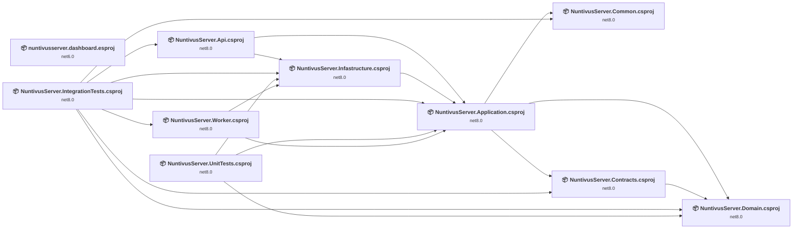

## Project Details

### NuntivusServer.Api\NuntivusServer.Api.csproj

#### Project Info

- **Current Target Framework:** net8.0
- **Proposed Target Framework:** net10.0
- **SDK-style**: True
- **Project Kind:** AspNetCore
- **Dependencies**: 2
- **Dependants**: 1
- **Number of Files**: 73
- **Number of Files with Incidents**: 7
- **Lines of Code**: 4284
- **Estimated LOC to modify**: 65+ (at least 1,5% of the project)

#### Dependency Graph

Legend:
📦 SDK-style project
⚙️ Classic project

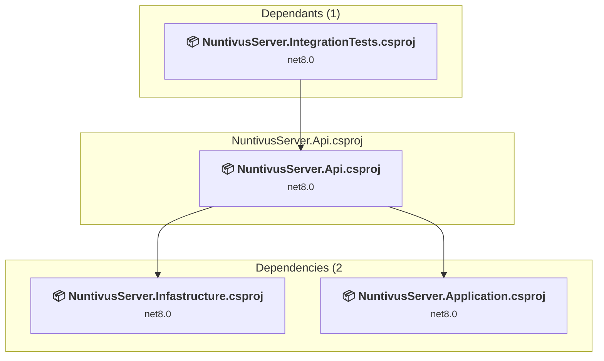

### API Compatibility

| Category | Count | Impact |
| :--- | :---: | :--- |
| 🔴 Binary Incompatible | 4 | High - Require code changes |
| 🟡 Source Incompatible | 43 | Medium - Needs re-compilation and potential conflicting API error fixing |
| 🔵 Behavioral change | 18 | Low - Behavioral changes that may require testing at runtime |
| ✅ Compatible | 7428 |  |
| ***Total APIs Analyzed*** | ***7493*** |  |

### NuntivusServer.Application\NuntivusServer.Application.csproj

#### Project Info

- **Current Target Framework:** net8.0
- **Proposed Target Framework:** net10.0
- **SDK-style**: True
- **Project Kind:** ClassLibrary
- **Dependencies**: 3
- **Dependants**: 5
- **Number of Files**: 188
- **Number of Files with Incidents**: 21
- **Lines of Code**: 11896
- **Estimated LOC to modify**: 57+ (at least 0,5% of the project)

#### Dependency Graph

Legend:
📦 SDK-style project
⚙️ Classic project

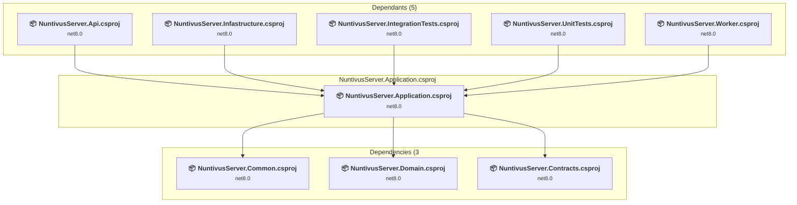

### API Compatibility

| Category | Count | Impact |
| :--- | :---: | :--- |
| 🔴 Binary Incompatible | 0 | High - Require code changes |
| 🟡 Source Incompatible | 7 | Medium - Needs re-compilation and potential conflicting API error fixing |
| 🔵 Behavioral change | 50 | Low - Behavioral changes that may require testing at runtime |
| ✅ Compatible | 11615 |  |
| ***Total APIs Analyzed*** | ***11672*** |  |

### NuntivusServer.Common\NuntivusServer.Common.csproj

#### Project Info

- **Current Target Framework:** net8.0
- **Proposed Target Framework:** net10.0
- **SDK-style**: True
- **Project Kind:** ClassLibrary
- **Dependencies**: 0
- **Dependants**: 2
- **Number of Files**: 5
- **Number of Files with Incidents**: 1
- **Lines of Code**: 316
- **Estimated LOC to modify**: 0+ (at least 0,0% of the project)

#### Dependency Graph

Legend:
📦 SDK-style project
⚙️ Classic project

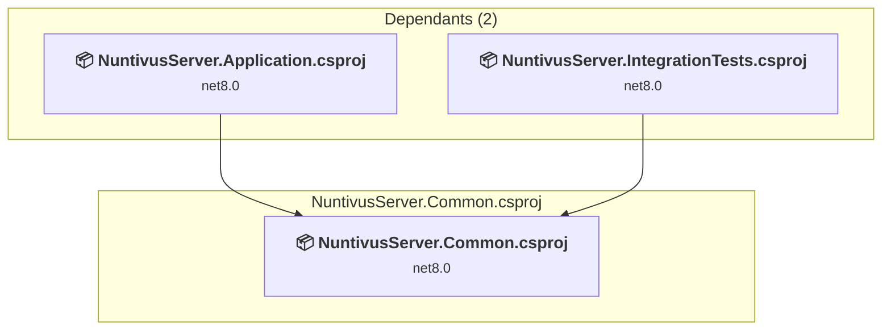

### API Compatibility

| Category | Count | Impact |
| :--- | :---: | :--- |
| 🔴 Binary Incompatible | 0 | High - Require code changes |
| 🟡 Source Incompatible | 0 | Medium - Needs re-compilation and potential conflicting API error fixing |
| 🔵 Behavioral change | 0 | Low - Behavioral changes that may require testing at runtime |
| ✅ Compatible | 326 |  |
| ***Total APIs Analyzed*** | ***326*** |  |

### NuntivusServer.Contracts\NuntivusServer.Contracts.csproj

#### Project Info

- **Current Target Framework:** net8.0
- **Proposed Target Framework:** net10.0
- **SDK-style**: True
- **Project Kind:** ClassLibrary
- **Dependencies**: 1
- **Dependants**: 2
- **Number of Files**: 65
- **Number of Files with Incidents**: 1
- **Lines of Code**: 851
- **Estimated LOC to modify**: 0+ (at least 0,0% of the project)

#### Dependency Graph

Legend:
📦 SDK-style project
⚙️ Classic project

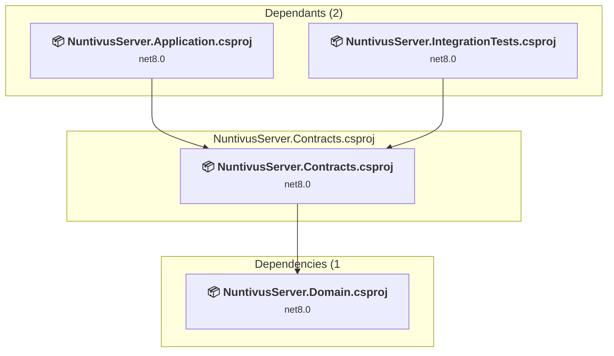

### API Compatibility

| Category | Count | Impact |
| :--- | :---: | :--- |
| 🔴 Binary Incompatible | 0 | High - Require code changes |
| 🟡 Source Incompatible | 0 | Medium - Needs re-compilation and potential conflicting API error fixing |
| 🔵 Behavioral change | 0 | Low - Behavioral changes that may require testing at runtime |
| ✅ Compatible | 4284 |  |
| ***Total APIs Analyzed*** | ***4284*** |  |

### NuntivusServer.Dashboard\nuntivusserver.dashboard.esproj

#### Project Info

- **Current Target Framework:** net6.0
- **Proposed Target Framework:** net10.0
- **SDK-style**: True
- **Project Kind:** DotNetCoreApp
- **Dependencies**: 0
- **Dependants**: 0
- **Number of Files**: 0
- **Number of Files with Incidents**: 1
- **Lines of Code**: 0
- **Estimated LOC to modify**: 0+ (at least 0,0% of the project)

#### Dependency Graph

Legend:
📦 SDK-style project
⚙️ Classic project

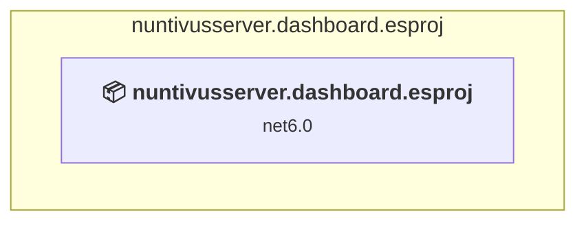

### API Compatibility

| Category | Count | Impact |
| :--- | :---: | :--- |
| 🔴 Binary Incompatible | 0 | High - Require code changes |
| 🟡 Source Incompatible | 0 | Medium - Needs re-compilation and potential conflicting API error fixing |
| 🔵 Behavioral change | 0 | Low - Behavioral changes that may require testing at runtime |
| ✅ Compatible | 0 |  |
| ***Total APIs Analyzed*** | ***0*** |  |

### NuntivusServer.Domain\NuntivusServer.Domain.csproj

#### Project Info

- **Current Target Framework:** net8.0
- **Proposed Target Framework:** net10.0
- **SDK-style**: True
- **Project Kind:** ClassLibrary
- **Dependencies**: 0
- **Dependants**: 4
- **Number of Files**: 35
- **Number of Files with Incidents**: 1
- **Lines of Code**: 2040
- **Estimated LOC to modify**: 0+ (at least 0,0% of the project)

#### Dependency Graph

Legend:
📦 SDK-style project
⚙️ Classic project

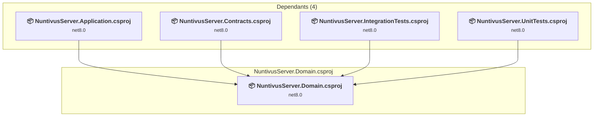

### API Compatibility

| Category | Count | Impact |
| :--- | :---: | :--- |
| 🔴 Binary Incompatible | 0 | High - Require code changes |
| 🟡 Source Incompatible | 0 | Medium - Needs re-compilation and potential conflicting API error fixing |
| 🔵 Behavioral change | 0 | Low - Behavioral changes that may require testing at runtime |
| ✅ Compatible | 2170 |  |
| ***Total APIs Analyzed*** | ***2170*** |  |

### NuntivusServer.Infastructure\NuntivusServer.Infastructure.csproj

#### Project Info

- **Current Target Framework:** net8.0
- **Proposed Target Framework:** net10.0
- **SDK-style**: True
- **Project Kind:** ClassLibrary
- **Dependencies**: 1
- **Dependants**: 4
- **Number of Files**: 95
- **Number of Files with Incidents**: 27
- **Lines of Code**: 12913
- **Estimated LOC to modify**: 74+ (at least 0,6% of the project)

#### Dependency Graph

Legend:
📦 SDK-style project
⚙️ Classic project

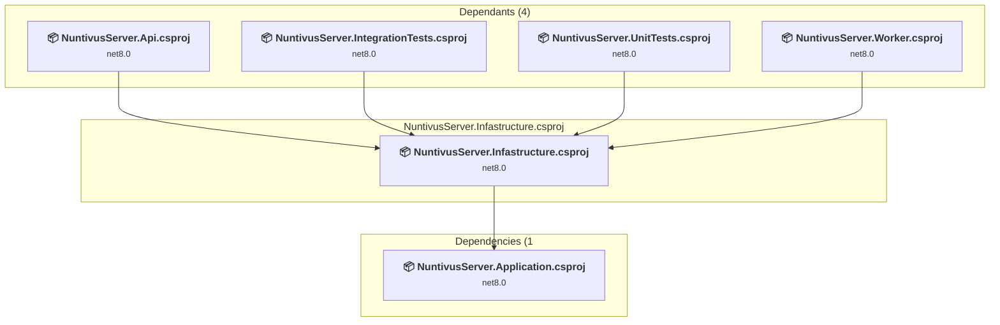

### API Compatibility

| Category | Count | Impact |
| :--- | :---: | :--- |
| 🔴 Binary Incompatible | 0 | High - Require code changes |
| 🟡 Source Incompatible | 20 | Medium - Needs re-compilation and potential conflicting API error fixing |
| 🔵 Behavioral change | 54 | Low - Behavioral changes that may require testing at runtime |
| ✅ Compatible | 13548 |  |
| ***Total APIs Analyzed*** | ***13622*** |  |

### NuntivusServer.IntegrationTests\NuntivusServer.IntegrationTests.csproj

#### Project Info

- **Current Target Framework:** net8.0
- **Proposed Target Framework:** net10.0
- **SDK-style**: True
- **Project Kind:** DotNetCoreApp
- **Dependencies**: 7
- **Dependants**: 0
- **Number of Files**: 53
- **Number of Files with Incidents**: 41
- **Lines of Code**: 13186
- **Estimated LOC to modify**: 396+ (at least 3,0% of the project)

#### Dependency Graph

Legend:
📦 SDK-style project
⚙️ Classic project

```mermaid
flowchart TB
    subgraph current["NuntivusServer.IntegrationTests.csproj"]
        MAIN["<b>📦&nbsp;NuntivusServer.IntegrationTests.csproj</b><br/><small>net8.0</small>"]
        click MAIN "#nuntivusserverintegrationtestsnuntivusserverintegrationtestscsproj"
    end
    subgraph downstream["Dependencies (7"]
        P3["<b>📦&nbsp;NuntivusServer.Common.csproj</b><br/><small>net8.0</small>"]
        P6["<b>📦&nbsp;NuntivusServer.Domain.csproj</b><br/><small>net8.0</small>"]
        P1["<b>📦&nbsp;NuntivusServer.Api.csproj</b><br/><small>net8.0</small>"]
        P10["<b>📦&nbsp;NuntivusServer.Worker.csproj</b><br/><small>net8.0</small>"]
        P7["<b>📦&nbsp;NuntivusServer.Infastructure.csproj</b><br/><small>net8.0</small>"]
        P2["<b>📦&nbsp;NuntivusServer.Application.csproj</b><br/><small>net8.0</small>"]
        P4["<b>📦&nbsp;NuntivusServer.Contracts.csproj</b><br/><small>net8.0</small>"]
        click P3 "#nuntivusservercommonnuntivusservercommoncsproj"
        click P6 "#nuntivusserverdomainnuntivusserverdomaincsproj"
        click P1 "#nuntivusserverapinuntivusserverapicsproj"
        click P10 "#nuntivusserverworkernuntivusserverworkercsproj"
        click P7 "#nuntivusserverinfastructurenuntivusserverinfastructurecsproj"
        click P2 "#nuntivusserverapplicationnuntivusserverapplicationcsproj"
        click P4 "#nuntivusservercontractsnuntivusservercontractscsproj"
    end
    MAIN --> P3
    MAIN --> P6
    MAIN --> P1
    MAIN --> P10
    MAIN --> P7
    MAIN --> P2
    MAIN --> P4

```

### API Compatibility

| Category | Count | Impact |
| :--- | :---: | :--- |
| 🔴 Binary Incompatible | 0 | High - Require code changes |
| 🟡 Source Incompatible | 67 | Medium - Needs re-compilation and potential conflicting API error fixing |
| 🔵 Behavioral change | 329 | Low - Behavioral changes that may require testing at runtime |
| ✅ Compatible | 24109 |  |
| ***Total APIs Analyzed*** | ***24505*** |  |

### NuntivusServer.UnitTests\NuntivusServer.UnitTests.csproj

#### Project Info

- **Current Target Framework:** net8.0
- **Proposed Target Framework:** net10.0
- **SDK-style**: True
- **Project Kind:** DotNetCoreApp
- **Dependencies**: 3
- **Dependants**: 0
- **Number of Files**: 36
- **Number of Files with Incidents**: 7
- **Lines of Code**: 3543
- **Estimated LOC to modify**: 27+ (at least 0,8% of the project)

#### Dependency Graph

Legend:
📦 SDK-style project
⚙️ Classic project

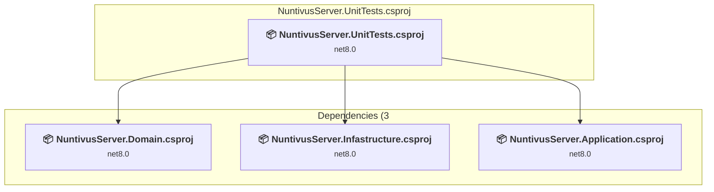

### API Compatibility

| Category | Count | Impact |
| :--- | :---: | :--- |
| 🔴 Binary Incompatible | 0 | High - Require code changes |
| 🟡 Source Incompatible | 11 | Medium - Needs re-compilation and potential conflicting API error fixing |
| 🔵 Behavioral change | 16 | Low - Behavioral changes that may require testing at runtime |
| ✅ Compatible | 4525 |  |
| ***Total APIs Analyzed*** | ***4552*** |  |

### NuntivusServer.Worker\NuntivusServer.Worker.csproj

#### Project Info

- **Current Target Framework:** net8.0
- **Proposed Target Framework:** net10.0
- **SDK-style**: True
- **Project Kind:** DotNetCoreApp
- **Dependencies**: 2
- **Dependants**: 1
- **Number of Files**: 28
- **Number of Files with Incidents**: 11
- **Lines of Code**: 2705
- **Estimated LOC to modify**: 36+ (at least 1,3% of the project)

#### Dependency Graph

Legend:
📦 SDK-style project
⚙️ Classic project

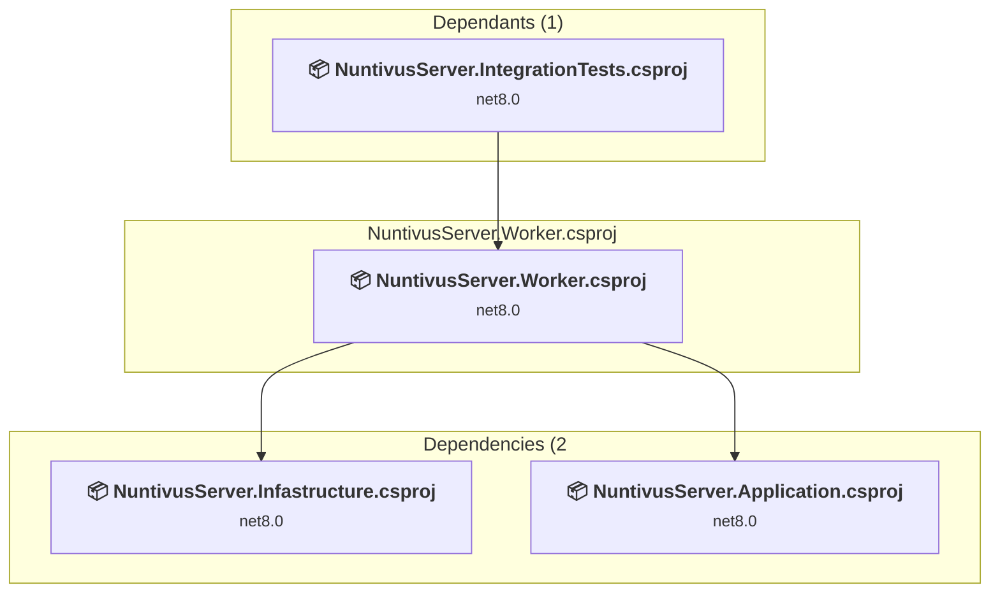

### API Compatibility

| Category | Count | Impact |
| :--- | :---: | :--- |
| 🔴 Binary Incompatible | 1 | High - Require code changes |
| 🟡 Source Incompatible | 13 | Medium - Needs re-compilation and potential conflicting API error fixing |
| 🔵 Behavioral change | 22 | Low - Behavioral changes that may require testing at runtime |
| ✅ Compatible | 3856 |  |
| ***Total APIs Analyzed*** | ***3892*** |  |

