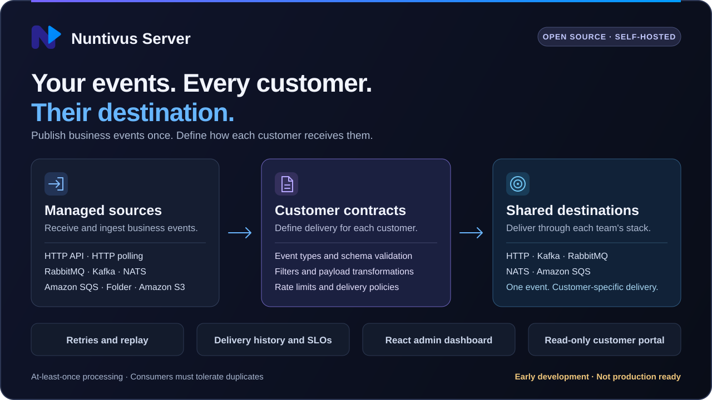
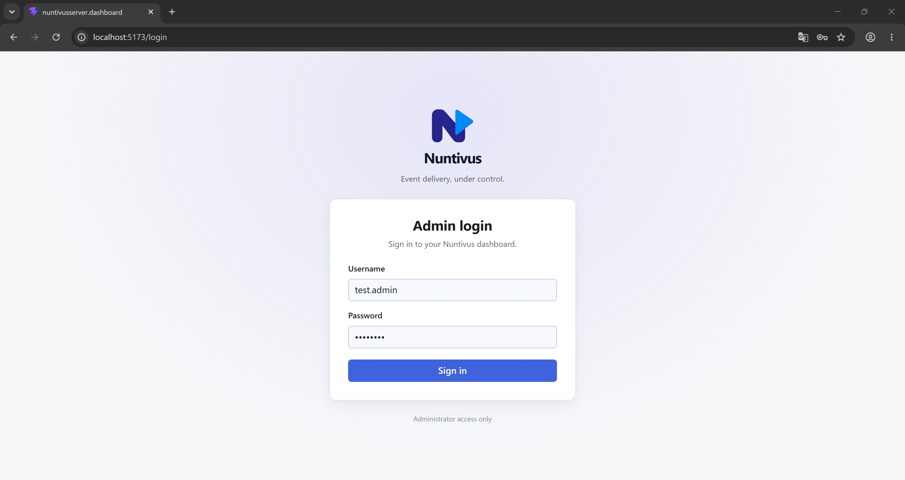
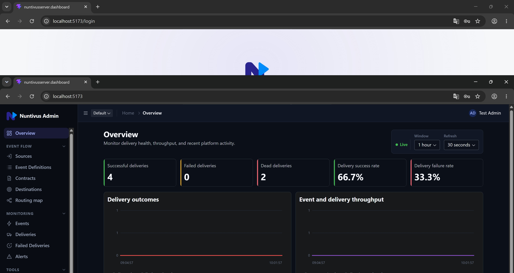
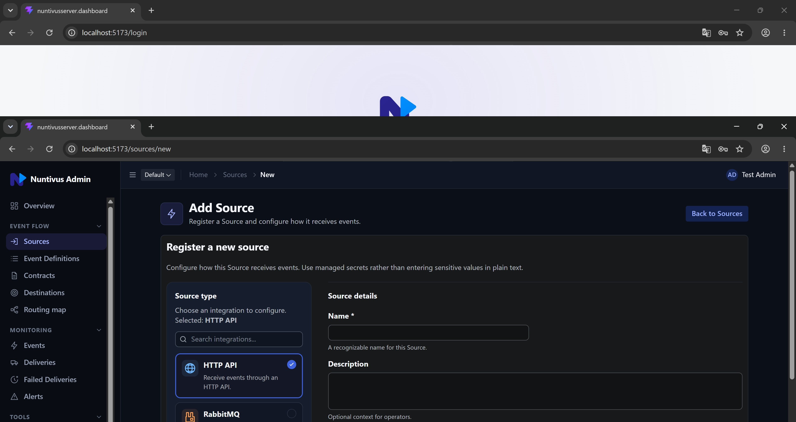
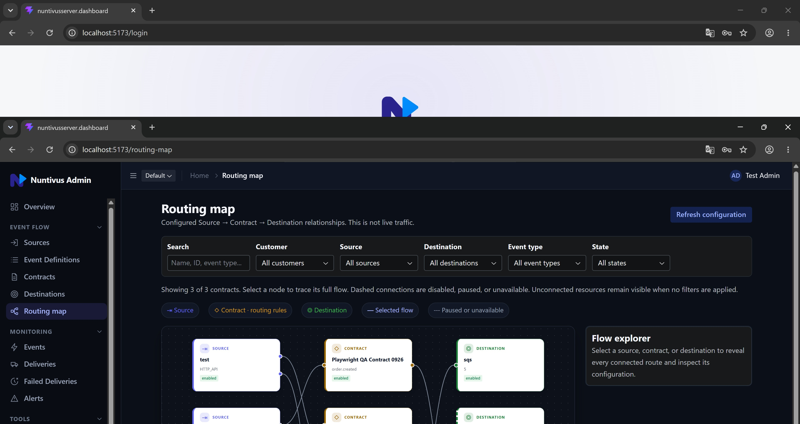
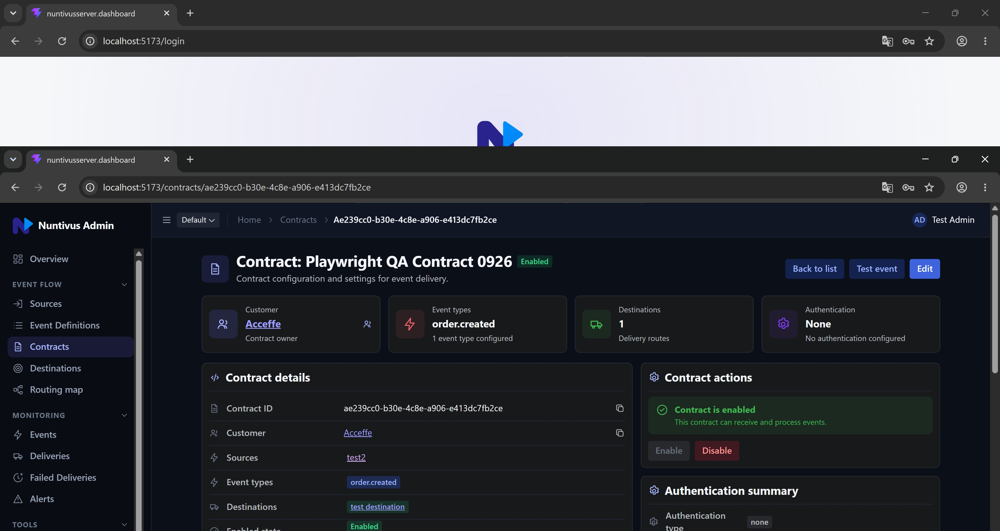
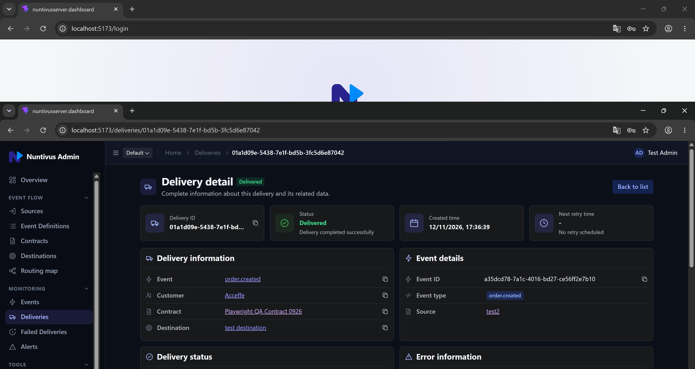

<p align="center">
  
</p>

<h1 align="center">Nuntivus</h1>

<p align="center">
	<a href="https://github.com/nuntivus/nuntivus/actions/workflows/ci.yml?query=branch%3Amain"></a>
  <a href="LICENSE"></a>
	<a href="NuntivusServer.Api/NuntivusServer.Api.csproj"></a>
  <a href="NuntivusServer.Dashboard/package.json"></a>
  <a href="docs/publication-readiness.md"></a>
</p>

<p align="center">
	<a href="https://github.com/nuntivus/nuntivus/releases"></a>
  <a href="https://github.com/nuntivus/nuntivus/commits/main/"></a>
  <a href="https://github.com/nuntivus/nuntivus/issues"></a>
  <a href="https://github.com/nuntivus/nuntivus/stargazers"></a>
</p>

<p align="center">
  <strong>Self-hosted customer event infrastructure for SaaS and platform teams.</strong><br />
  Publish business events once; define how each customer receives them.
</p>

[Website](https://www.nuntivus.com) · [Quick start](#docker-quick-start-local-only) · [Features](#features) · [Documentation](#documentation) · [Contributing](#contributing)

> **Early development — not yet production ready.** APIs, schemas, and configuration
> may change before the first stable release.



## Features

- 🔌 **Managed sources** — HTTP and pull Sources, with source-scoped ingestion idempotency.
- 👥 **Customer contracts** — shared destinations, filters, and delivery policies.
- 📡 **Delivery integrations** — HTTP, Kafka, RabbitMQ, NATS, and SQS.
- 🧩 **Event processing** — schema validation, compatibility review, typed transformations, and dry runs.
- 📊 **Delivery operations** — history, retries/replay, SLOs, alerts, and staff metadata exports.
- 🖥️ **Administration** — React dashboard and invitation-only read-only customer portal.

Processing is **at least once**; external consumers must tolerate duplicates.
See the [architecture](docs/architecture.md) and [feature limitations](docs/features/product-verification.md).

## Dashboard screenshots

Preview the administration dashboard, from sign-in to source configuration and delivery monitoring.

| Sign-in | Dashboard overview |
| --- | --- |
|  |  |

| Sources | Routes |
| --- | --- |
|  |  |

| Contracts | Deliveries |
| --- | --- |
|  |  |

## Docker quick-start (local only)

Requires Docker Engine/Desktop with Linux containers and Docker Compose 2.24.4+.
Clone this repository and run from its root. The application is built from local
source; host installations of .NET and Node.js and an `.env` file are not needed.

From the repository root, run:

```sh
docker compose -f docker-compose.quickstart.yml up -d --wait
```

Compose builds the API, worker, and dashboard from the checkout instead of pulling
application images from Docker Hub. PostgreSQL, NATS, Docker build base images,
and build packages may still be downloaded. It generates unique database and NATS
credentials, an encryption key, a signing key, and an initial administrator
password; applies migrations; and starts the complete application. The Dashboard's
API address is configured automatically. Subsequent starts rebuild from local source
using Docker's build cache.

Open **http://localhost:5173** and sign in as **admin**. Retrieve the generated
initial password locally:

```sh
docker compose -f docker-compose.quickstart.yml exec -T api cat /run/nuntivus-api/admin-password
```

Keep this password private. It is not a shared default and is not printed in
startup logs. Existing administrators and generated secrets are preserved on
subsequent starts; the command retrieves the original bootstrap password, not a
replacement for a password you later change.

Only the Dashboard and API (`http://localhost:8080`) publish loopback-bound ports.
PostgreSQL, NATS, and Worker ports remain private. The stack intentionally runs in
Development mode for local HTTP and loopback CORS. **Do not expose this stack
publicly or use it as a production deployment.** If ports 5173 or 8080 are already
in use, stop the conflicting local services before starting.

```sh
docker compose -f docker-compose.quickstart.yml ps
docker compose -f docker-compose.quickstart.yml down
docker compose -f docker-compose.quickstart.yml up -d --wait
```

`down` keeps data and secrets in the `nuntivus-quickstart` project's named volumes.
Back up database, NATS, and secret volumes together; do not remove secret volumes
while keeping the database. Adding `--volumes` to `down` **permanently deletes the
local installation**, including its data and encryption keys. The source-based
development workflow below and production deployment remain separate.

## Development quick-start

Requires Docker Compose 2.24.4+ with Linux containers and PowerShell 5.1+.
The default stack is for local experimentation only and uses development
credentials on loopback-bound ports. Never reuse the checked-in development
passwords or signing/encryption sample keys in a deployment. Node.js and .NET
run inside Docker.

```sh
git clone <repository-url> nuntivus-server
cd nuntivus-server
```

Replace `<repository-url>` with this repository's HTTPS or SSH clone URL.

Start backend **and frontend** with one command:

```powershell
.\start.ps1
```

The script starts PostgreSQL, NATS JetStream, migrations, API, Worker and the
dashboard in the isolated `nuntivus-local` Compose project. It waits for readiness
and offers initial administrator setup only when no admin exists. Dashboard:
`http://localhost:5173`; API readiness: `http://localhost:8080/health/ready`;
development Swagger: `http://localhost:8080/swagger`.

```powershell
.\start.ps1 -Services be                 # Backend and its dependencies only
.\start.ps1 -Services fe                 # Frontend only; use an existing API
.\start.ps1 -Services postgres,nats      # Selected infrastructure only
.\start.ps1 -ApiPort 8081 -FrontendPort 5174
.\start.ps1 -Action status
.\start.ps1 -Action stop                 # Stop API, Worker and dashboard
.\start.ps1 -Action down                 # Stop the entire local project; keep data
```

PostgreSQL/NATS have no published host ports, so an existing NATS on port `4222`
is left untouched. `-Services` also accepts `api`, `worker` and `migrate`; Compose
starts their required dependencies. Use `-ApiBaseUrl` for a frontend targeting
another API, `-NoBuild` to reuse backend images, and `-SkipAdminSetup` for
noninteractive startup. `-ProjectName` selects a separate local project. On a
restricted Windows execution policy, run
`powershell.exe -NoProfile -ExecutionPolicy Bypass -File .\start.ps1` without
changing the machine policy. Stopping selected apps leaves infrastructure
running; `-Action down` removes containers/networks, not data volumes.

### Alternative: run the dashboard on the host

For host-side frontend development, Node.js 24 is required. Start only the
backend with `.\start.ps1 -Services be`, then:

```sh
cd NuntivusServer.Dashboard
npm ci
npm run dev
```

Set `VITE_API_BASE_URL=http://localhost:8080` in the dashboard's `.env.local` when
using the Compose API. Open the URL printed by Vite. There is no pre-seeded admin
password: follow the [admin authentication guide](docs/self-hosting/admin-authentication.md)
to provision a local account or configure an identity provider.

### Ingest an event

Create a managed Source, then publish to `POST /v1/sources/{id}/events`.
A minimal event contains `idempotencyKey`, `type`, and a JSON object `payload`.
See [Source setup and envelope examples](docs/sources.md). The old direct event
publish and generic webhook routes are not supported.

## Production deployment

Do **not** deploy the development Compose file publicly.
Use [production configuration](docs/self-hosting/production-configuration.md)
and `docker-compose.prod.yml` with generated secrets and configured authentication.
PostgreSQL and NATS stay inside the container network; expose the API through a
trusted HTTPS reverse proxy.

Read the [operations guides](docs/self-hosting/README.md) for backups, restores,
upgrades, and deployment-specific acceptance checks.

See [Compose deployment modes](docs/self-hosting/compose-deployments.md) to start
API and worker independently on one host or deploy them on separate hosts using
shared PostgreSQL and NATS infrastructure.

## Development and tests

Projects target .NET 10; the solution uses the SDK pinned in `global.json`.
The dashboard is validated separately through npm.

See [development and validation](docs/development.md) for setup, builds, backend
tests, browser tests, dependency audits, and supported toolchains.

## Documentation

- [Documentation index](docs/README.md)
- [Concepts and architecture](docs/architecture.md)
- [Sources](docs/sources.md)
- [Delivery ordering guarantees](docs/delivery-ordering-guarantees.md)
- [Feature coverage and limitations](docs/features/product-verification.md)
- [Self-hosting operations](docs/self-hosting/README.md)
- [Publishing a clean public repository](docs/publication-readiness.md)

## Contributing

Read [CONTRIBUTING.md](CONTRIBUTING.md) before opening a pull request.
Report vulnerabilities privately according to [SECURITY.md](SECURITY.md).

## License

Nuntivus Server is open source under the [Apache License 2.0](LICENSE).
Commercial use, modification, redistribution, and hosting are permitted subject
to its terms. Third-party dependencies and assets retain their applicable licenses.
